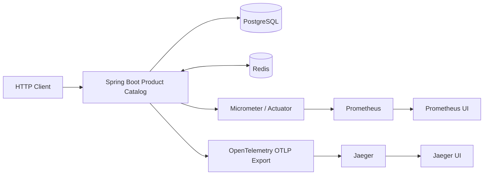

# Observability Architecture for a Spring Boot Product Catalog Service

**Sample type:** System architecture  
**Implementation:** [Product Catalog service](../../product-catalog-service)  
**Signals:** Prometheus metrics and OpenTelemetry traces, visualized with Jaeger

Observability is useful when it helps an engineer move from “the service is slow” to a specific operation, dependency, or code path worth investigating. This blueprint instruments a small Spring Boot service and runs the observability components locally with Docker Compose.

The architecture is intentionally a single service with supporting infrastructure. It is not an event-driven microservices platform: there is no message broker or asynchronous event choreography in the current implementation.

## 1. Architecture at a glance

The Product Catalog API uses PostgreSQL as its system of record and Redis as a cache. The application emits metrics and traces through separate telemetry paths.



The local Compose environment starts PostgreSQL, Redis, the application, Prometheus, and Jaeger. Prometheus scrapes the application's metrics endpoint. The application exports traces using OTLP to Jaeger.

## 2. Metrics: measure behavior without unbounded labels

Spring Boot Actuator exposes the Prometheus scrape endpoint at:

```text
/actuator/prometheus
```

The service uses Micrometer and the Prometheus registry. In addition to framework and JVM metrics, product creation is instrumented with a named observation:

```text
catalog.product.create
```

The observation uses a bounded `operation=create` tag. It deliberately does not attach product IDs or SKUs as metric labels. Those values are high-cardinality dimensions and can cause time-series growth that makes a metrics backend expensive and difficult to operate.

The Compose stack makes Prometheus available at `http://localhost:9090`. The CI smoke test creates a product and verifies that the custom product-creation metric is scraped.

## 3. Traces: follow an operation across application boundaries

The service uses Spring Boot's OpenTelemetry integration and exports traces over OTLP. The application-level sampling probability defaults to 10% and can be configured with `TRACING_SAMPLING_PROBABILITY`.

For the local demonstration, Compose uses 100% sampling so a developer can reliably find the requests they just sent. The OTLP traces endpoint is configurable through `OTEL_EXPORTER_OTLP_TRACES_ENDPOINT`; the Compose network points the application to Jaeger's OTLP receiver.

Jaeger UI is available at `http://localhost:16686`. Select the `product-catalog-service` service and search for recent traces.

The repository also includes a deliberately slow development-only endpoint at `/internal/dev/slow`. It waits for 1.5 seconds and emits a named observation to make trace inspection straightforward. The endpoint is enabled only under the `dev` profile; an integration test confirms it is not registered under the default profile.

## 4. Why metrics and traces are complementary

Metrics are efficient for aggregate questions: Is request latency increasing? Are errors rising? Is the JVM under pressure? They are well suited to dashboards and alert evaluation.

Traces help investigate individual requests. They show the sequence and duration of instrumented operations and can expose where time is spent.

A useful workflow is:

1. Notice an increase in latency or errors in a metric.
2. Select a representative time window and operation.
3. Inspect traces for that service and interval.
4. Identify the slow span or dependency interaction.
5. Reproduce the behavior and validate a fix with tests and measurements.

The current blueprint demonstrates the telemetry plumbing and a custom application observation. It does not claim to provide a complete production SLO, alerting, or distributed-service tracing strategy.

## 5. Verify the complete path in CI

The repository's Compose smoke test starts the stack, waits for application health, creates a product through the HTTP API, checks that Prometheus can scrape the custom metric, and verifies trace ingestion by Jaeger. It also checks that the development-only endpoint remains unavailable under the default profile.

This is stronger evidence than checking that the application merely compiles: the test exercises the running containers and the telemetry path end to end.

## 6. Operational considerations before production

The local stack is a reproducible development environment. A production observability deployment still needs decisions about:

- Metrics and trace retention, storage sizing, and backup.
- Access control for dashboards and telemetry endpoints.
- Alert rules, ownership, escalation, and on-call procedures.
- Sampling policy and protection against sensitive data in span attributes.
- Network isolation for management and telemetry interfaces.
- Resource budgets and failure behavior when telemetry backends are unavailable.

The application exposes health, info, metrics, and Prometheus endpoints on its application port in the current sample. A production deployment should isolate or secure management endpoints rather than exposing them indiscriminately.

## Summary

This architecture connects a Spring Boot service to PostgreSQL and Redis while exporting metrics to Prometheus and traces to Jaeger. It demonstrates bounded-cardinality instrumentation, configurable sampling, a development-only slow operation, and a CI smoke test that verifies telemetry ingestion.

**Explore the code and Compose configuration:** [java-microservices-blueprints](https://github.com/FatmaEmran/java-microservices-blueprints)
